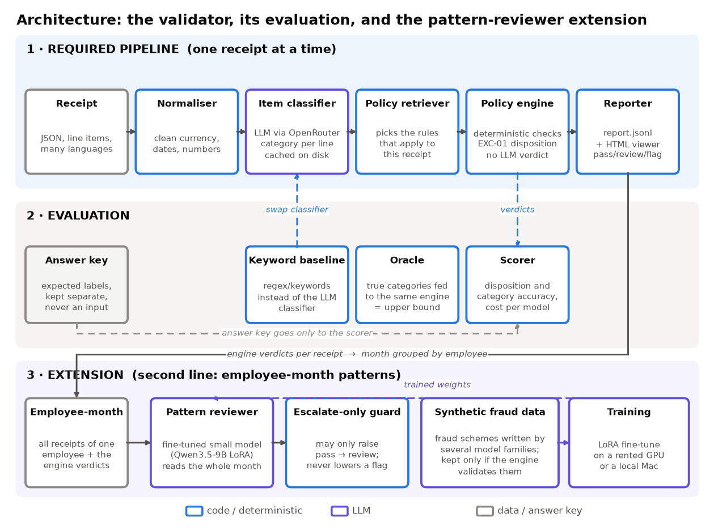
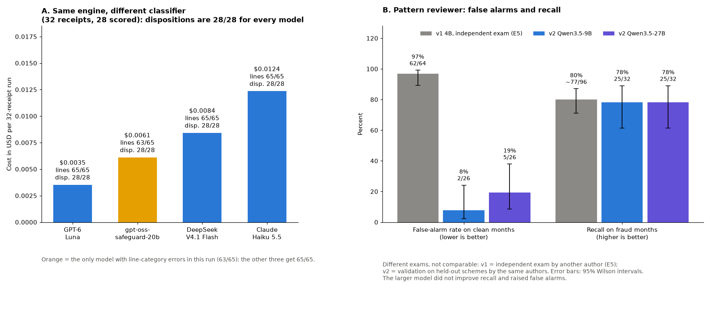
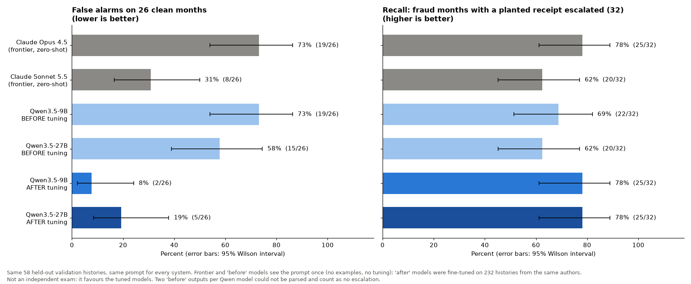
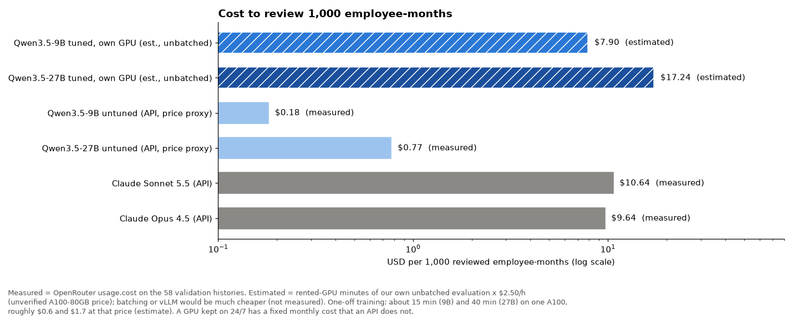

# Expense Policy Validator

Reads itemized expense receipts, classifies every line item, applies the written expense policy with a **deterministic rule engine**, and reports each exception with the rule and the policy text behind it. Disposition: `flag`, `review` or `pass`.



## Run it
```
uv sync --group dev --group viewer
uv run python -m validator.run                      # offline, from the committed cache: no key, no network → output/report.jsonl
uv run pytest                                       # 971 tests
uv run --group viewer streamlit run viewer/app.py   # viewer: receipt list, receipt detail, metrics
uv run python -m validator.evaluation.evaluate      # regenerates output/EVAL.md (reads the answer key, evaluation only)
```
Live classification needs `OPENROUTER_API_KEY` (or `ANTHROPIC_API_KEY`) in `.env` (see `.env.example`; never committed) and an explicit `--out`, so a live run cannot overwrite the committed results: `uv run python -m validator.run --out output/live`. `scripts/compare_models.py` runs several OpenRouter models side by side (own cache and output per model, spend cap).

## Architecture
- **Normaliser** (deterministic): NFKC, control characters removed, whitespace collapsed; `description_raw` never changes. Translation is done by the classifier (English rendering in the same call).
- **Item classifier**: `openai/gpt-oss-safeguard-20b` through OpenRouter, prompt v3. One call per receipt returns category (21 taxonomy categories), restricted flag, confidence band and the stated recipient of gifts. Cached by sha256 of model + prompt + content: re-runs cost nothing.
- **Retriever**: a table of predicates over items, MCC and metadata (37 rows); no vector database. A rule it misses raises an error instead of being skipped.
- **Engine**: pure Python. USD thresholds, carve-outs that need recorded evidence, regional overrides (APAC beats global), cross-receipt rules (MEAL-01, REG-03), EXC-01. 41 rules, 37 with their own check. TIME-01..04 are implemented and resolve the four stretch receipts (not scored, as the brief says).
- **Reporter**: copies the exact policy text and line ids for every finding.

## Prompts
The classifier prompt holds the taxonomy text only, never the answers; it returns JSON (category, band `high`/`medium`/`low`, English rendering, recipient). Temperature 0. v1→v3 were compared on a 144-line held-out set written independently of the dataset; v3 was kept because it extracts gift recipients, which a rule needs (RCP-022).

## Policy engine
One module per policy document (`src/validator/rules/`), each rule citing its id; boundaries follow the text exactly (`$189` dock passes, `$329` monitor without pre-approval does not); a carve-out never applies without its recorded evidence (RCP-027). **EXC-03 threshold:** confidence below **0.5** (band `low` = 0.3, `medium` = 0.7, `high` = 0.9; ordinal, not calibrated) removes the line from every rule and raises a review signal. It fired 0 times on the dataset.

## Evaluation (28 scored receipts, 65 lines; `output/EVAL.md`)
| | A LLM | B ORACLE (perfect categories) | C KEYWORD |
|---|---|---|---|
| Disposition accuracy | 28/28 | 27/28 | 21/28 |
| False positives (of 9 pass) / missed (of 16 flag) | 0 / 0 | 0 / 1 | 1 / 4 |
| Macro F1 / restricted F1 | 0.965 / 1.000 | gold | 0.776 / 0.821 |



*Same engine, four classifier models, one run each (the committed run of the safeguard model got 64/65 lines; ±1 line is run-to-run variation). Right panel: the pattern reviewer, v1 vs v2; different exams, not comparable.*

28 receipts is tiny (a perfect score has a 95% lower bound of 87.7%). The engine was written with these receipts and answers in view, so B is a consistency check, not a generalisation estimate; only the classifier is measured blind, and the taxonomy's own examples sit in its prompt. On the 65 scored lines it makes one error (RCP-005-L2 'Occupancy tax' → `other`, correct `lodging`; the disposition is still right). On the held-out set (144 lines, independent of the dataset) it scores 124/144 exact (86.1%; 136/144 counting listed alternatives). Per-rule precision/recall, exact line citation (26/26) and the four timing receipts (4/4) are in `EVAL.md`.
**Failure cases.** (1) RCP-022 under B: with perfect categories the engine passes it, because who received the items is stated only in the text; the classifier's recipient output fires GIFT-04, so a perfect category score would not have caught it. (2) Held-out: 20 of 144 lines differ from the annotator, e.g. "Cerveza Corona Cero" → `alcohol` (it is non-alcoholic beer); 13 of the 20 are rated `high` and only 1 `low`, so EXC-03 catches almost none (stage: classification).
**Base rate.** The dataset is 57% violations; a real stream has a few percent. With 0 false flags seen in only 12 non-flag receipts, the true false-alarm rate could be up to 26.5% (95% bound), which at 3% prevalence would make as few as 8.5% of flags real. So 0/9 false positives says little about what reviewers would see. Before production I would measure precision on a random sample at the real rate, per-rule precision, and the calibration of the confidence bands.

## Why fine-tune a model, and own it
Rules only catch what someone thought of in advance, and fraud keeps inventing schemes, so a second line that reads the whole month is worth having. Renting that judgment from a frontier model has costs: it is generic (here, zero-shot Opus 4.5 flagged 73% of the clean months), its price and behaviour change with the provider, and receipts leave the company. A small model the team owns can learn the organisation's own notion of "suspicious", runs on its own infrastructure with no per-call fee, is pinned to a version (weights, prompt and engine move together), and sits behind two guards: it can only escalate `pass → review`, and the engine keeps the verdict.



Same 58 held-out histories and the same prompt for every system. Tuning Qwen3.5-9B took its false alarms from 73% to 8% (2/26) and its recall from 69% to 78%; Opus 4.5 reaches the same 78% recall (25/32) but with 19/26 false alarms. Measured cost of the frontier runs on these histories: $0.56 for Opus 4.5 and $0.62 for Sonnet 5.5 (about $0.01 per history), against inference on owned hardware. **What this does not show:** the frontier models saw the prompt once, with no examples (a few examples would lower their false alarms; not measured); the exam is from the same authors and style as the training data, which favours the tuned model; the anti-shortcut gate still fails (0.657) and the intervals are wide. It supports "fewer false alarms at equal recall in this exam" and nothing more.

**Cost, stated plainly.** Measured with OpenRouter's `usage.cost`, reviewing 1,000 employee-months costs about $9.64 with Opus 4.5 and $10.64 with Sonnet 5.5. Our tuned model on a rented A100 in our own unbatched harness comes to roughly $7.90 (9B) and $17.24 (27B) per 1,000 (an estimate: GPU minutes × an unverified $2.50/h), i.e. **not cheaper than the API at this scale**; batching or vLLM would cut it a lot, but that is not measured. One-off training took about 15 min (9B) and 40 min (27B), roughly $0.6 and $1.7 at the same price. So the case for owning the model rests on false alarms at equal recall, on control (data stays in-house, version pinned, no provider price or behaviour changes) and on the escalate-only guard, not on a cheaper bill; a GPU kept on 24/7 also adds a fixed monthly cost that an API does not.



## Key decisions (`DECISIONS.md`)
Answer key physically split from the pipeline and enforced by a test; all 32 receipts processed (group rules need context), 28 scored; baseline frozen by hash before scoring; disposition and every threshold in code, the model only classifies; fail closed (a model error gives `review`, never `pass`).

## Extension: cross-receipt pattern reviewer (beyond the brief)
The engine judges one receipt at a time, so it cannot see schemes that only show across a month (spend split under a cap, a pre-approval reused). A second-line LLM reads an employee-month and may **only escalate `pass → review`**; the engine keeps the verdict. Training data: synthetic fraud histories that the engine passes (several model families, validated by the real engine). I also fine-tuned a small line classifier (Qwen3-4B, LoRA, 417 synthetic lines): 90.4% exact versus 98.3% for a frontier model and 63.9% before tuning, so it does not replace the classifier above; training a model on only the 65 official lines would have leaked the exam.
**Results, as they are:** v1 (Qwen3-4B) looked strong on its own generator (88% recall, 0% false alarms) but on an independent exam by another author it had 80% recall and 97% false alarms; a counterfactual showed a weekend shortcut. v2 data (290 histories, code-controlled sampler, several authors) lowers the shortcut, but the anti-shortcut gate still fails (surface-feature AUROC 0.657, target ≤ 0.60). Qwen3.5-9B (QLoRA, loss on the answer only), validated on 58 held-out histories from the same authors: planted receipt escalated in 25/32 fraud histories (78%, 95% CI 61–89%), 2/26 false alarms on clean months (7.7%, CI 2–24%); receipt-level precision 0.93, recall 0.72. Not an independent exam, so it supports "far fewer false alarms than v1" and nothing about frontier models. Qwen3.5-27B, same data and recipe: the same recall (25/32) with more false alarms, 5/26 (19%, CI 9–38%), receipt-level precision 0.88: a bigger model did not help, so the limit is the data, not the model size. Notebooks in `notebooks/`; code, data and logs in `extension_pattern_reviewer/`.

## Data, services and spend
Synthetic data. Receipts and policy text are sent to **OpenRouter** (the key Oversight provided), which routes the classifier calls, and to the AI coding assistants used to build this. `tests/test_no_leak.py` blocks `labels`/`notes` from reaching the pipeline. Extension only: generated months went to Anthropic, DeepSeek and Kimi models; fine-tuning ran on a rented GPU and a local Mac.
**Model and spend:** `openai/gpt-oss-safeguard-20b`, OpenAI's policy-reasoning model, $0.075 / $0.30 per million tokens in/out. OpenRouter's own `usage.cost`: the 32-receipt run $0.0064 ($0.0002 per receipt, 0 failures); the 41-call held-out run $0.0134; the four-model comparison (`output/compare/`) $0.0304; key usage for this work $0.050 in total, matching the dashboard. **Trade-off:** against `claude-haiku-5.5` on the same engine it gives the same 28/28 dispositions at about half the price, but it is less accurate on unseen text (held-out 86.1% vs 95.1%) and rarely flags its own mistakes as low confidence. Choosing a production model needs a larger sample.

## One receipt end to end
RCP-014 (supermarket, 4 lines): the classifier returns `household_goods` for detergent, paper towels and dish soap and `alcohol` (restricted, `high`) for "Cooking wine - Marsala 375ml" → the retriever selects the household, alcohol and merchant rules → the engine fires **ALC-03** on L4 (alcohol from a non-restaurant is never reimbursable), **HOUSE-01** on L1–L3 and **DOC-03**, plus the review signal **MCC-02** (medium-risk MCC 5411, not an exception) → EXC-01 gives `flag` → the reporter quotes the policy sentence for each finding with its line ids.

## AWS
`AWS_DESIGN.md`: async API Gateway + SQS + Lambda, policy bundle versioned in S3 (a policy change is a code change, shipped with tests), key in Secrets Manager, ~$420–700/month at 50,000 receipts/day.

## Known limits and next steps
Thresholds use the recorded USD amount with a 1% tolerance, so a wrong conversion can pass; a malformed field disables its rule family and the verdict falls to `review`; gift recipients are matched by the model's exact name text; TIME-04 cannot be measured because trip records carry nights but no dates; a model outage aborts the CLI. Next: validate recorded USD against the receipt's own rate, normalise MCC and entity inputs, calibrate confidence and EXC-03 on a labelled sample at a realistic violation rate, and keep the pattern reviewer only if it beats a frontier comparator on a blind exam.

## AI collaboration (full account: `AI_LOG.md`)
I used AI assistants as a tool to build and check the work; the design and the judgment about the data are mine. **Mine:** the architecture (a deterministic engine owns the verdict; a second-line reviewer can only escalate `pass → review`); fine-tuning a small local model for cross-receipt fraud, trained on synthetic fraud that the engine classifies as `pass`; red-team agents to remove my own bias as author; data from several model families because one family shares blind spots; an exam independent of the training generator; a blind audit of the synthetic labels. **The assistant:** code, experiment runs, drafts and audits. **What it got wrong and how it was caught:** training data with a weekend shortcut (counterfactual experiment); Opus 4.5 API results that did not represent the model (a rejected request parameter); a README line the code contradicted and an AWS cost taken from an older run (final audit); viewer rendering bugs (screenshots). **Checks:** answer key out of the pipeline with a leak test; baseline frozen by hash; success criteria written before results; five independent audits, one recomputing every metric from raw files.
